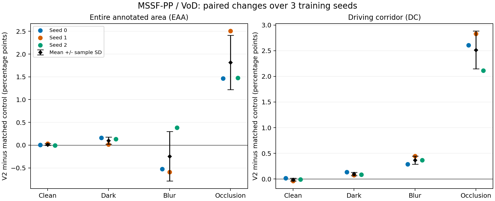

# MSSF-PP 可靠性感知融合 V2

分支：`feat/reliability-gate-v2`，从 V1 全量退化分析提交 `8fde873` 创建。V1 的模型、配置和结果保留在原分支/标签及 `README_reliability_fusion.md` 中。

当前阶段：代码与接入验证完成，共新增 18820 个参数、4 个门控。完整 V2 与 query-only 均已完成 seed=0、1、2 的训练和完整评测；query-only 两个复验种子的队列于 2026-11-02 12:43:45 全部结束。

## 设计与边界

V1 在图像退化时门控仍约为 0.99。V2 将特征权重改为 `g = 2 * sigmoid(z)`，最后一层权重和偏置置零，使有效投影上的初始 `g=1`。在相同 logit 导数尺度下，初始斜率为 0.5，而 V1 的 0.99 sigmoid 门控斜率约 0.0099。这只改善局部可学习性，不保证精度提升。

V2 具有两类独立门控，每个融合阶段均可单独启用：

- **query 图像入口**：在采样图像特征进入原 `query_proj` 混合投影前加权，保留雷达特征和位置输入。
- **注意力图像增量**：延续 V1 的位置，在图像增量投影后、原查询残差相加前加权。

门控输入为实际雷达/图像特征、可学习空间的一致性、投影几何，以及未归一化特征的 log-energy。权重范围为 0–2，可降低或放大特征，不能解释为已校准的置信概率。无效投影屏蔽图像项，但不等同独立雷达单模态模型。

训练时有 50% 概率对图像随机施加变暗、模糊或局部遮挡，另外 50% 为清晰样本。原始图像文件、雷达、标注和几何矩阵保持不变。训练扰动强度与位置随机，验证与测试默认仍使用原图；全量退化评测另行固定条件。

清晰样本约束为 `loss_gate_clean = λ * sum_valid_clean((g-1)^2) / N_valid_clean`，默认 λ=0.1。它**只限制门控在清晰样本上的漂移**，不是冻结教师的整网预测一致性，不保证其他可训练参数或预测完全不变。增强标记仅参与训练损失的样本选择，不进入门控预测网络。

V2 控制组与门控组均固定 BatchNorm/SyncBN 的运行统计量，仿射参数仍按原冻结策略决定是否训练；这是 V2 共同实验设置，因此应使用 V2 新控制组，不能直接把 V1 控制组视作完全匹配对照。图像分支沿用原参数冻结策略。默认体网络学习率 1e-5，新门控参数为其 10 倍；6 epoch、batch size 1、seed 0。以上是候选实验设置，并非已验证的最佳参数。

## 修改文件与入口

<!-- FILE_LOCATIONS_START -->

| 文件与入口行 | 修改内容 |
|---|---|
| [mmdet3d/models/layers/fusion_layers/reliability_gate_v2.py:10](mmdet3d/models/layers/fusion_layers/reliability_gate_v2.py#L10) | 居中权重、能量特征、训练用清晰样本约束缓存 |
| [mmdet3d/models/layers/fusion_layers/query_reliability.py:22](mmdet3d/models/layers/fusion_layers/query_reliability.py#L22) | 在原 query 混合投影之前门控图像项 |
| [mmdet3d/models/layers/fusion_layers/radar_img_cross_att.py:360](mmdet3d/models/layers/fusion_layers/radar_img_cross_att.py#L360) | 为 V2 透传清晰损失掩码，V1 保持原接口行为 |
| [mmdet3d/models/layers/fusion_layers/voxel_fusion_block.py:82](mmdet3d/models/layers/fusion_layers/voxel_fusion_block.py#L82) | 为注意力门控提供仅用于损失的清晰标记 |
| [mmdet3d/models/middle_encoders/pillar_scatter_fuse.py:143](mmdet3d/models/middle_encoders/pillar_scatter_fuse.py#L143) | 第一阶段 query 图像入口 |
| [mmdet3d/models/backbones/second_fuse.py:209](mmdet3d/models/backbones/second_fuse.py#L209) | 第二阶段 query 图像入口 |
| [mmdet3d/models/detectors/voxelnet_fuse.py:57](mmdet3d/models/detectors/voxelnet_fuse.py#L57) | 可选固定 BN 统计；loss 包装器汇总并消费清晰约束 |
| [mmdet3d/models/layers/fusion_layers/__init__.py:7](mmdet3d/models/layers/fusion_layers/__init__.py#L7) | 注册 V2 门控，保留 V1 类 |
| [mmdet3d/datasets/transforms/image_degradation.py:11](mmdet3d/datasets/transforms/image_degradation.py#L11) | 训练退化和含可靠性元信息的打包器 |
| [mmdet3d/datasets/transforms/__init__.py:4](mmdet3d/datasets/transforms/__init__.py#L4) | 注册 V2 数据变换 |
| [mmdet3d/engine/hooks/reliability_experiment_hook.py:28](mmdet3d/engine/hooks/reliability_experiment_hook.py#L28) | 支持独立 README/结果索引路径，默认 V1 路径不变 |
| [tools/analysis_tools/reliability_robustness.py:193](tools/analysis_tools/reliability_robustness.py#L193) | 支持自定义 V2 配置、checkpoint、README 与归档路径 |
| [tests/test_reliability_fusion_v2.py:26](tests/test_reliability_fusion_v2.py#L26) | 9 项 V2 行为、梯度、元信息隔离及消融配置检查 |
| [repro/reliability_fusion_v2/results.json:1](repro/reliability_fusion_v2/results.json#L1) | V2 独立的运行摘要索引 |
| [README.md:106](README.md#L106) | 项目入口链接 |
| [.gitignore:15](.gitignore#L15) | 忽略 V2 的临时结果锁文件 |
| [README_reliability_fusion_v2.md:1](README_reliability_fusion_v2.md#L1) | V2 功能、限制、配置、命令与结果记录 |
| [configs/experiments/reliability_fusion_v2/control_aug.py:2](configs/experiments/reliability_fusion_v2/control_aug.py#L2) | V2 控制、消融或接入检查配置；详下方配置表 |
| [configs/experiments/reliability_fusion_v2/control_clean.py:2](configs/experiments/reliability_fusion_v2/control_clean.py#L2) | V2 控制、消融或接入检查配置；详下方配置表 |
| [configs/experiments/reliability_fusion_v2/gate_attention_clean.py:2](configs/experiments/reliability_fusion_v2/gate_attention_clean.py#L2) | V2 控制、消融或接入检查配置；详下方配置表 |
| [configs/experiments/reliability_fusion_v2/gate_aug_attention_only.py:2](configs/experiments/reliability_fusion_v2/gate_aug_attention_only.py#L2) | V2 控制、消融或接入检查配置；详下方配置表 |
| [configs/experiments/reliability_fusion_v2/gate_aug_no_anchor.py:2](configs/experiments/reliability_fusion_v2/gate_aug_no_anchor.py#L2) | V2 控制、消融或接入检查配置；详下方配置表 |
| [configs/experiments/reliability_fusion_v2/gate_both_clean.py:2](configs/experiments/reliability_fusion_v2/gate_both_clean.py#L2) | V2 控制、消融或接入检查配置；详下方配置表 |
| [configs/experiments/reliability_fusion_v2/gate_main.py:2](configs/experiments/reliability_fusion_v2/gate_main.py#L2) | V2 控制、消融或接入检查配置；详下方配置表 |
| [configs/experiments/reliability_fusion_v2/smoke_inference.py:2](configs/experiments/reliability_fusion_v2/smoke_inference.py#L2) | V2 控制、消融或接入检查配置；详下方配置表 |
| [configs/experiments/reliability_fusion_v2/smoke_train.py:2](configs/experiments/reliability_fusion_v2/smoke_train.py#L2) | V2 控制、消融或接入检查配置；详下方配置表 |
| [repro/reliability_fusion_v2/verification.json:1](repro/reliability_fusion_v2/verification.json#L1) | 本次测试、梯度、BN 统计、源码哈希和真实接入记录 |
| [tools/analysis_tools/run_reliability_v2.py:1](tools/analysis_tools/run_reliability_v2.py#L1) | GPU 0 顺序运行三个正式实验，保存状态、日志与代码哈希，失败时停止后续实验 |
| [repro/reliability_fusion_v2/formal-seed0-20261030.json:1](repro/reliability_fusion_v2/formal-seed0-20261030.json#L1) | 首轮三个正式实验的逐轮指标、固定第 6 轮对比、权重哈希及证据 |
| [repro/reliability_fusion_v2/robustness/full-v2-conclusion-20261031.json:1](repro/reliability_fusion_v2/robustness/full-v2-conclusion-20261031.json#L1) | V2 完整退化评测的对比、逐类差值、门控响应与核验结论 |
| [repro/reliability_fusion_v2/multiseed/summary-20261031.json:1](repro/reliability_fusion_v2/multiseed/summary-20261031.json#L1) | 三个 seed 的配对均值、样本标准差、逐类指标、门控分布与来源 |
| [repro/reliability_fusion_v2/multiseed/training-seeds0-1-2-20261031.json:1](repro/reliability_fusion_v2/multiseed/training-seeds0-1-2-20261031.json#L1) | 六个正式训练运行的完整逐轮记录和权重哈希 |
| [repro/reliability_fusion_v2/multiseed/next-ablation-steps.md:1](repro/reliability_fusion_v2/multiseed/next-ablation-steps.md#L1) | 两项消融的目标、完整运行命令与判断标准 |
| [tools/analysis_tools/run_reliability_v2_ablation.sh:1](tools/analysis_tools/run_reliability_v2_ablation.sh#L1) | 两项 seed=0 消融的顺序训练和完整评测入口 |
| [configs/experiments/reliability_fusion_v2/gate_aug_query_only.py:1](configs/experiments/reliability_fusion_v2/gate_aug_query_only.py#L1) | 仅保留 query 门控的互补消融配置 |
| [repro/reliability_fusion_v2/ablation/summary-seed0-20261031.json:1](repro/reliability_fusion_v2/ablation/summary-seed0-20261031.json#L1) | 两项消融相对完整 V2 和匹配控制的指标、逐类差值及核验 |
| [repro/reliability_fusion_v2/ablation/training-seed0-20261031.json:1](repro/reliability_fusion_v2/ablation/training-seed0-20261031.json#L1) | 两项 seed=0 消融的逐轮训练验证记录 |
| [repro/reliability_fusion_v2/ablation/next-query-only-steps.md:1](repro/reliability_fusion_v2/ablation/next-query-only-steps.md#L1) | query_only 下一步命令与判断标准 |
| [repro/reliability_fusion_v2/ablation/query-only-seed0-summary-20261102.json:1](repro/reliability_fusion_v2/ablation/query-only-seed0-summary-20261102.json#L1) | query-only 完整结果及与注意力门控/完整 V2 的组件比较 |
| [repro/reliability_fusion_v2/ablation/next-query-only-repeats-20261102.md:1](repro/reliability_fusion_v2/ablation/next-query-only-repeats-20261102.md#L1) | query-only seed=1、2 复验命令、配对控制及 NAS 输出路径 |

<!-- FILE_LOCATIONS_END -->

## 配置及消融

所有配置位于 `configs/experiments/reliability_fusion_v2/`：

| 配置 | 用途 |
|---|---|
| `control_clean.py` | 原结构、无图像退化，验证 V2 共同训练设置 |
| `control_aug.py` | 原结构＋图像退化，隔离增强本身的收益 |
| `gate_attention_clean.py` | 仅 V2 注意力门控包，无退化、无清晰约束（同时包含居中参数化与能量特征） |
| `gate_both_clean.py` | query＋注意力门控、清晰约束，无退化 |
| `gate_aug_attention_only.py` | 与主版本相同退化/约束，关闭 query 门控 |
| `gate_aug_no_anchor.py` | 与主版本相同退化/两类门控，关闭清晰约束 |
| `gate_main.py` | V2 主候选：两类门控＋退化训练＋清晰约束 |
| `smoke_inference.py` | 前 16 帧、未训练的初始恒等门控 |
| `smoke_train.py` | 四次优化器更新，仅接入验证 |

V2 从**官方 `exps/mssf_pp_vod/epoch_40.pth`** 初始化，不继承 V1 的近饱和门控权重。新增参数缺失是预期初始化；其他缺失或形状不匹配需要处理。正式训练之前固定代码提交。四步检查 checkpoint 不能用作正式模型。

## 接入检查

```bash
conda activate mssf-bench
cd '/home/d514/桌面/zcy/MSSF_zcy'
git switch feat/reliability-gate-v2
python tests/test_reliability_fusion_v2.py
```

16 帧推理：

```bash
RUN="work_dirs/reliability_fusion_v2/smoke_inference/$(date +%Y%m%d_%H%M%S)"
mkdir -p "$RUN"
python -u tools/test.py configs/experiments/reliability_fusion_v2/smoke_inference.py \
  --checkpoint exps/mssf_pp_vod/epoch_40.pth --metric VODMetric \
  --work-dir "$RUN" --pkl_save_dir "$RUN/predictions" 2>&1 | tee "$RUN/console.log"
```

四步反向传播：

```bash
RUN="work_dirs/reliability_fusion_v2/smoke_train/$(date +%Y%m%d_%H%M%S)"
mkdir -p "$RUN"
python -u tools/train.py configs/experiments/reliability_fusion_v2/smoke_train.py \
  --work-dir "$RUN" 2>&1 | tee "$RUN/console.log"
```

## 正式实验

先完成 `control_clean.py` 与 `control_aug.py`，再运行 `gate_main.py`；其他配置用于比较最简 V2 注意力门控包、query 入口、增强和清晰约束。当前未单独消融能量特征，因此不能把最简 V2 与旧版的差异仅归因于门控函数或初始化。各运行使用独立 `work_dirs/reliability_fusion_v2/<variant>/<timestamp>`。同一 GPU 顺序运行。

训练命令模板：

```bash
RUN="work_dirs/reliability_fusion_v2/gate_main/$(date +%Y%m%d_%H%M%S)"
mkdir -p "$RUN"
nohup env CUDA_VISIBLE_DEVICES=0 python -u tools/train.py \
  configs/experiments/reliability_fusion_v2/gate_main.py \
  --work-dir "$RUN" > "$RUN/console.log" 2>&1 < /dev/null &
tail -f "$RUN/console.log"
```

主版本应与 `control_aug.py` 的同预算结果比较，并分别报告是否超过官方未额外微调基线。所有配置的训练/验证 Hook 均只更新本 V2 README 和 `repro/reliability_fusion_v2/results.json`，不会覆盖 V1 结果。完整逐轮历史在运行目录的 `reliability_result.json` 中；表中只显示每次运行最近一次验证值。


### 顺序队列

使用已激活的 mssf-bench 环境，在项目根目录执行：

```bash
QUEUE="work_dirs/reliability_fusion_v2/queue/$(date +%Y%m%d_%H%M%S)"
mkdir -p "$(dirname "$QUEUE")"
nohup python -u tools/analysis_tools/run_reliability_v2.py --work-dir "$QUEUE" > "${QUEUE}.log" 2>&1 < /dev/null &
```

队列顺序为 control_clean、control_aug、gate_main，各 6 epoch、seed 0、batch size 1，均从官方 epoch_40.pth 初始化。队列的 status.json 记录进程、每组目录、代码提交与源文件哈希，失败时停止。每组 console.log 位于各自运行目录；SSH 断开后继续运行。代码在运行期间应保持不变。首组启动后，结果 Hook 自动更新 README/结果 JSON，所以后续组的全工作区 dirty 标记可能为真；队列仍逐组核对算法文件哈希与提交，确保代码一致。

## 训练后退化评测

沿用固定条件的诊断工具，显式给出 V2 配置、正式 checkpoint 和 V2 输出位置：

```bash
python tools/analysis_tools/reliability_robustness.py --samples 1296 \
  --conditions clean dark blur occlusion \
  --control-config configs/experiments/reliability_fusion_v2/control_aug.py \
  --gate-config configs/experiments/reliability_fusion_v2/gate_main.py \
  --control-checkpoint PATH_TO_CONTROL_EPOCH_6 \
  --gate-checkpoint PATH_TO_V2_EPOCH_6 \
  --readme README_reliability_fusion_v2.md \
  --archive-dir repro/reliability_fusion_v2/robustness \
  --work-dir UNIQUE_RUN_DIRECTORY
```

上述大写项需替换成真实训练产物路径。该脚本用于精度与门控响应，不用于测量 FPS；合成退化不代表真实夜间/天气。query 与注意力门控会分别统计。

## 本次验证记录

验收证据：[repro/reliability_fusion_v2/verification.json](repro/reliability_fusion_v2/verification.json)。实现代码提交为 `e237d7f`。

- 22 项测试通过：9 项 V2 测试、7 项 V1 回归、6 项退化诊断回归。
- 有效投影上的初始门控为 1；固定输入的注意力输出与冻结基线源码逐元素一致，query 图像入口初始也保持恒等。
- 16 帧真实推理完成，普通 EAA/DC 为 25.0645%/17.7489%，与原基线相同样本的接入检查一致。仅为小样本流程验证。
- 4 次优化器更新正常完成，四个门控的输出层权重均从零更新，243 个 BN 运行统计缓冲量与官方 checkpoint 逐项一致。
- 真实清晰批次的独立探针确认约束损失大于零，四个门控均收到非零梯度；同一批次改为非清晰标记后，该约束为零。探针只在丢弃的内存模型中临时设置偏置，没有覆盖任何 checkpoint。
- V2 的 4 帧 clean/blur 诊断接口通过，可分别记录 query 与注意力四个门控并写入独立 V2 归档。使用的是未训练、初始权重为 1 的 V2 检查 checkpoint，不是鲁棒性实验结论。
- 官方 checkpoint 与 V1 已训练 checkpoint 均仍可严格加载；V1 README、结果索引及全量结论文件与 `8fde873` 保持逐字节一致。

初始恒等门控和小样本训练只证明实现可用，不代表已经学到可靠性，也不能作为完整验证集成绩。四步检查的工作区 dirty 标记来自前一轮推理自动生成的 V2 结果文档；算法文件与记录中的实现提交一致。正式实验前应提交结果文档并确认工作区状态。

首先执行 V2 控制组，而非直接复用 V1 控制结果：`control_clean.py`、`control_aug.py`、`gate_main.py`，分别使用独立目录和相同预算。

## 训练与评测结果（自动更新）

<!-- RELIABILITY_RESULTS_START -->

| 实验 | 类型/状态 | 样本数 | 验证 epoch | EAA mAP (%) | DC mAP (%) | 代码 | 运行目录 |
|---|---|---:|---:|---:|---:|---|---|
| v2-untrained-inference | smoke_only | 16 | — | 25.0645 | 17.7489 | e237d7f1 | work_dirs/reliability_fusion_v2/smoke_inference/20261030_175948 |
| v2-four-iteration-backward | smoke_only | — | — | — | — | e237d7f1+dirty | work_dirs/reliability_fusion_v2/smoke_train/20261030_180638 |
| v2-control-clean | training_completed | 1296 | 6 | 63.2782 | 79.7903 | bfa3c22d | work_dirs/reliability_fusion_v2/control_clean/20261030_214524 |
| v2-control-aug | training_completed | 1296 | 6 | 63.5594 | 79.9024 | bfa3c22d+dirty | work_dirs/reliability_fusion_v2/control_aug/20261030_214524 |
| v2-main | training_completed | 1296 | 6 | 63.5679 | 79.9167 | bfa3c22d+dirty | work_dirs/reliability_fusion_v2/gate_main/20261030_214524 |
| v2-control_aug-seed1 | training_completed | 1296 | 6 | 63.5765 | 79.9682 | 9b6cf69f | work_dirs/reliability_fusion_v2/multiseed/20261031_100513/seed1/control_aug |
| v2-gate_main-seed1 | training_completed | 1296 | 6 | 63.6084 | 79.9280 | 9b6cf69f+dirty | work_dirs/reliability_fusion_v2/multiseed/20261031_100513/seed1/gate_main |
| v2-control_aug-seed2 | training_completed | 1296 | 6 | 63.4854 | 79.8451 | 9b6cf69f+dirty | work_dirs/reliability_fusion_v2/multiseed/20261031_100513/seed2/control_aug |
| v2-gate_main-seed2 | training_completed | 1296 | 6 | 63.4799 | 79.8369 | 9b6cf69f+dirty | work_dirs/reliability_fusion_v2/multiseed/20261031_100513/seed2/gate_main |
| v2-gate_aug_attention_only-seed0 | training_completed | 1296 | 6 | 63.6246 | 79.9244 | 96585b3d | work_dirs/reliability_fusion_v2/ablation/20261031_152210/gate_aug_attention_only |
| v2-gate_aug_no_anchor-seed0 | training_completed | 1296 | 6 | 63.5951 | 79.9448 | 96585b3d+dirty | work_dirs/reliability_fusion_v2/ablation/20261031_152210/gate_aug_no_anchor |
| v2-query-only-inference-smoke | smoke_only | 16 | — | 25.0645 | 17.7489 | 96585b3d+dirty | work_dirs/reliability_fusion_v2/verification/query_only_20261031_201158 |
| v2-gate_aug_query_only-seed0 | training_completed | 1296 | 6 | 63.5144 | 79.8779 | e9b3f255 | work_dirs/reliability_fusion_v2/ablation/query_only_20261031_201602/gate_aug_query_only |
| v2-gate_aug_query_only-seed1 | training_completed | 1296 | 6 | 63.5458 | 79.9236 | 64b79b92 | work_dirs/reliability_fusion_v2/ablation/nas/query_only_repeat_20261102_110041/seed1/gate_aug_query_only |
| v2-gate_aug_query_only-seed2 | training_completed | 1296 | 6 | 63.4769 | 79.8412 | 64b79b92+dirty | work_dirs/reliability_fusion_v2/ablation/nas/query_only_repeat_20261102_110041/seed2/gate_aug_query_only |

<!-- RELIABILITY_RESULTS_END -->

## 受控图像退化诊断（自动更新）

<!-- ROBUSTNESS_RESULTS_START -->

完整验证集受控退化评测。同一批 1296 帧、固定所指定的两组权重，无训练。运行 `20261102_123324`；合成退化不等同真实夜间或恶劣天气。

| 条件 | 样本数 | 对照 EAA | 门控 EAA | 门控减对照 | 对照 DC | 门控 DC | 门控减对照 |
|---|---:|---:|---:|---:|---:|---:|---:|
| clean | 1296 | 63.4854 | 63.4769 | -0.0085 | 79.8451 | 79.8412 | -0.0039 |
| dark | 1296 | 56.3481 | 56.4238 | +0.0757 | 73.2276 | 73.3347 | +0.1071 |
| blur | 1296 | 50.3926 | 50.6219 | +0.2293 | 68.1452 | 68.2423 | +0.0971 |
| occlusion | 1296 | 48.1980 | 48.3443 | +0.1463 | 68.6256 | 70.1630 | +1.5374 |

| 条件 | 门控阶段 | 有效查询门控均值 | 标准差 | 低于 0.9 的比例 |
|---|---|---:|---:|---:|
| clean | backbone/query | 1.0133688 | 0.0555096 | 0.03933 |
| clean | middle_encoder/query | 1.0133567 | 0.0464446 | 0.03778 |
| dark | backbone/query | 1.0303969 | 0.0789922 | 0.05889 |
| dark | middle_encoder/query | 0.9308669 | 0.0821611 | 0.34291 |
| blur | backbone/query | 0.8690688 | 0.1244612 | 0.63971 |
| blur | middle_encoder/query | 0.8789124 | 0.0880243 | 0.56700 |
| occlusion | backbone/query | 1.0749983 | 0.1022817 | 0.04022 |
| occlusion | middle_encoder/query | 0.9118707 | 0.1253584 | 0.44515 |

[完整参数、逐类指标与门控分布](repro/reliability_fusion_v2/robustness/20261102_123324.json)

<!-- ROBUSTNESS_RESULTS_END -->

## V2 首轮正式实验结论

<!-- FORMAL_V2_SEED0_START -->

三个实验均正常退出，各训练 5139 帧 × 6 epoch = 30834 步，验证 1296 帧，seed=0；统一比较预先固定的第 6 epoch，没有选择各组最优 epoch。代码提交 bfa3c22，队列记录的全部源文件哈希与审核时一致。后两组 dirty 标记来自前组自动更新 README/结果 JSON，算法文件没有变化。

| 实验 | EAA mAP (%) | DC mAP (%) |
|---|---:|---:|
| 官方权重，本机未微调基线 | 63.2253 | 79.7823 |
| V2 control_clean，无增强 | 63.2782 | 79.7903 |
| V2 control_aug，同等图像增强 | 63.5594 | 79.9024 |
| V2 gate_main，增强＋门控＋清晰约束 | 63.5679 | 79.9167 |

口径为普通 3D AP 的 entire_area/map 与 roi/map，不是 R40/strict/BEV/AOS。截图 10/30 22:26:14 的结果属于 control_clean，而非 gate_main。

- 增强相对无增强控制：EAA +0.2812、DC +0.1121 个百分点。
- V2 主版本相对同增强控制：EAA +0.0085、DC +0.0143 个百分点。
- V2 主版本相对本机官方权重：EAA +0.3426、DC +0.1344 个百分点，但包含额外训练和增强，不能全归因于门控。

本轮干净集上的数值增益主要来自增强。门控与约束组合相对匹配控制的增益很小，单种子不足以认定有效或显著。四个门控输出层已从零初始化更新，训练日志也有非零清晰约束；这仅证明模块参与学习，不证明已学会可靠性。上述为当时的干净集结论；后续完整退化评测结果见下节，不能据单种子结果宣称普遍鲁棒性改善。

后续已固定 control_aug 与 gate_main 的 epoch_6.pth 完成同一 1296 帧的 clean/dark/blur/occlusion 评测，结果见下节。

[完整逐轮指标、checkpoint SHA-256 与审核证据](repro/reliability_fusion_v2/formal-seed0-20261030.json)

<!-- FORMAL_V2_SEED0_END -->

## V2 完整退化评测结论（2026-10-31）

对照为同增强的 control_aug，主模型为 gate_main；都使用固定第 6 轮权重。八组均完成 1296 帧，样本索引为 0–1295，checkpoint 哈希与正式训练归档一致。评测源码提交 f446c3f，启动时工作区干净，算法源文件哈希与训练队列一致。

| 图像条件 | 对照 EAA | V2 EAA | 差值（百分点） | 对照 DC | V2 DC | 差值（百分点） |
|---|---:|---:|---:|---:|---:|---:|
| clean | 63.5609 | 63.5679 | +0.0070 | 79.9024 | 79.9167 | +0.0143 |
| dark | 56.4797 | 56.6386 | +0.1589 | 73.1134 | 73.2465 | +0.1331 |
| blur | 51.5202 | 50.9930 | -0.5272 | 68.1297 | 68.4166 | +0.2869 |
| occlusion | 48.0431 | 49.5090 | +1.4659 | 68.3006 | 70.9080 | +2.6074 |

- 遮挡收益最大，且三个类别在 EAA 和 DC 下均提高；DC 行人 AP 从 49.6440 提高到 55.2099（+5.5659 个百分点）。
- 模糊不是全面改善：EAA 行人 AP 从 42.2073 降为 39.6209（-2.5864），是该区域 mAP 下降的主要来源；DC 三类均小幅提高。
- backbone 注意力门控均值：clean 0.983952、dark 0.849941、blur 0.948726、occlusion 0.645133；遮挡时低于 0.9 的比例从 8.04% 升至 64.69%。其他门控也会随部分退化改变，说明 V2 已有输入相关响应，不能据此单独归因性能收益。
- 全部记录的投影均有效，本次没有验证无效投影分支的实际收益。
- clean 对照重复评测 EAA 为 63.5609，原训练验证记录为 63.5594，差 0.0015 个百分点；checkpoint 哈希相同，差异来源未单独定位。原记录保留，退化对比统一使用本次评测值。
- 当前只支持单种子、固定合成退化下的观察，不能认定统计显著或真实夜间/天气均有效；门控与清晰约束的各自贡献仍待消融。

后续已完成 seed=1、2 配对实验，汇总见下节。下一步先用 seed=0 进行 attention_only 与 no_anchor 消融，再根据结果决定补齐种子及算法改动。

[核验与逐类差值 JSON](repro/reliability_fusion_v2/robustness/full-v2-conclusion-20261031.json)；[本轮完整原始汇总](repro/reliability_fusion_v2/robustness/20261031_093806.json)。

## 三个 seed 的正式汇总（2026-10-31）

训练 seed 为 0、1、2，评测固定 seed=0。两组均从同一官方预训练权重微调 6 epoch，各 30834 步；所有结果来自固定第 6 轮、同一 1296 帧和相同合成退化。seed=1、2 队列于 13:26 完整结束，24 组模型/条件评测均有效。六个最终权重和配置哈希已核对，运行期算法源文件哈希一致。dirty 标记来自自动结果更新。V1 结果保持不变。

### 配对收益

下表为每个训练 seed 内 V2 减同增强控制组，然后对三个差值求均值及样本标准差（ddof=1），单位为百分点；± 不是置信区间。

| 条件 | EAA 配对差值，均值 ± SD | DC 配对差值，均值 ± SD | EAA/DC 为正的 seed 数 |
|---|---:|---:|---|
| clean | +0.0111 ± 0.0190 | -0.0114 ± 0.0274 | 2/3；1/3 |
| dark | +0.1015 ± 0.0775 | +0.0984 ± 0.0306 | 3/3；3/3 |
| blur | -0.2443 ± 0.5452 | +0.3670 ± 0.0801 | 1/3；3/3 |
| occlusion | +1.8171 ± 0.5976 | +2.5161 ± 0.3682 | 3/3；3/3 |

| 条件 | 对照 EAA，均值 ± SD (%) | V2 EAA，均值 ± SD (%) | 对照 DC，均值 ± SD (%) | V2 DC，均值 ± SD (%) |
|---|---:|---:|---:|---:|
| clean | 63.5409 ± 0.0487 | 63.5521 ± 0.0657 | 79.9052 ± 0.0616 | 79.8939 ± 0.0497 |
| dark | 56.4275 ± 0.0699 | 56.5291 ± 0.0951 | 73.1950 ± 0.0711 | 73.2934 ± 0.0407 |
| blur | 51.2126 ± 0.7175 | 50.9683 ± 0.1804 | 68.1789 ± 0.0776 | 68.5459 ± 0.1534 |
| occlusion | 47.7568 ± 0.6347 | 49.5740 ± 0.0898 | 68.5305 ± 0.2001 | 71.0466 ± 0.3980 |



### 解释与边界

- 遮挡的 EAA/DC 在三个 seed 均提高，分别为 +1.8171 ± 0.5976、+2.5161 ± 0.3682 个百分点，是目前最有重复支持的结果。
- 干净集没有稳定的精度收益；这里没有做等效性检验，不能将基本持平当作严格证明完全不损精度。
- 变暗在三个 seed 均小幅提高。模糊 DC 也三次提高，但 EAA 两负一正，平均 -0.2443 ± 0.5452。
- 模糊 EAA 中 Car/Cyclist 在三个 seed 均提高；行人配对变化为 -2.5864、-2.2873、+0.3431，平均 -1.5102 ± 1.6120。应优先检查这类目标及其空间分布。
- backbone 注意力门控的每 seed 均值再取平均：clean 0.98783、dark 0.84515、blur 0.94798、occlusion 0.65837。两个 query 门控在 blur 的平均值约为 0.87761 和 0.89002，相比 clean 的 1.00962 和 1.02100 有抑制。该相关性提示可测试 query 组件，尚不能证明它导致了行人退步。
- 当前结果是门控加清晰约束整体相对同增强控制的效果，尚未分离各个组件。全部实测投影有效，也未测出无效投影分支的实际收益。
- 三个 seed 都从同一个官方预训练 checkpoint 开始，只覆盖微调随机性；使用的是训练中见过的合成退化类型。不能宣称统计显著、真实天气普遍有效或超越其他论文方法。
- seed=0 控制组重新评测 clean EAA 为 63.5609，原训练验证为 63.5594；同权重的小差异未单独定位，原记录保留，所有退化配对均使用各自本轮评测值。

### 接下来的实验

后续已完成 gate_aug_attention_only 与 gate_aug_no_anchor 的 seed=0 实验，结果见下节；下一步补 query_only，再对关键组件配置补 seed=1、2，之后讨论 V3。

[多种子汇总 JSON](repro/reliability_fusion_v2/multiseed/summary-20261031.json)；[六个训练运行记录](repro/reliability_fusion_v2/multiseed/training-seeds0-1-2-20261031.json)；[下一步完整操作命令](repro/reliability_fusion_v2/multiseed/next-ablation-steps.md)。

## seed=0 组件消融结果（2026-10-31）

两项训练均为 6 epoch、30834 步；各完成四条件 × 两模型 × 1296 帧评测。源码提交 96585b3，所有 checkpoint 和配置哈希、相同控制权重及原始样本索引均已核对。两项实验是单 seed 筛查，不能当作多种子组件结论。

下表每个单元为普通 3D AP 的 EAA / DC (%)。

| 条件 | 完整 V2 | 关闭 query 门控 | 关闭清晰约束 |
|---|---:|---:|---:|
| clean | 63.5679 / 79.9167 | 63.6246 / 79.9244 | 63.5951 / 79.9448 |
| dark | 56.6386 / 73.2465 | 56.5179 / 73.0787 | 56.6613 / 73.2495 |
| blur | 50.9930 / 68.4166 | 50.6874 / 68.3685 | 50.8794 / 68.3783 |
| occlusion | 49.5090 / 70.9080 | 49.4842 / 69.2434 | 49.6233 / 70.9987 |

- 关闭 query 后，模糊 EAA/DC 相对完整 V2 为 -0.3056/-0.0481 个百分点，行人 EAA 也再降 0.1913。因此本轮不支持将模糊退步直接归因于 query 门控。
- 关闭 query 后，遮挡 DC 下降 1.6646 个百分点，主要表现为 DC 行人 AP 下降 4.8742；完整 V2 暂保留 query 组件。
- 关闭清晰约束后，干净 EAA/DC +0.0272/+0.0281、遮挡 +0.1143/+0.0907、模糊 -0.1136/-0.0383。变化较小且只有一个 seed，当前不能证明约束必要或不必要。
- 各次控制组 checkpoint 完全相同，但 clean EAA 有最大约 0.0015 的重复评测差异，原始记录均保留。表格比较模型本身 AP；JSON 同时记录各自运行内的控制差值。
- 下一步只运行 gate_aug_query_only：保留两个 query 门控、关闭两个注意力输出门控，补齐无门控/仅注意力/仅 query/两者都有的组合。anchor 仍按活动门控求平均，结果应解释为组件整体消融。

[完整消融汇总](repro/reliability_fusion_v2/ablation/summary-seed0-20261031.json)；[query_only 操作命令](repro/reliability_fusion_v2/ablation/next-query-only-steps.md)。

query_only 接入检查：CPU 模型确认只有两个 query 门控，官方权重仅缺少预期的 24 个新参数键；16 帧真实推理完成，初始恒等门控的 EAA/DC 为 25.0645/17.7489，与同前缀基线一致。这是未训练小样本验证，不是正式精度结果。此接入检查后，query-only 正式 seed=0 训练及完整评测已于 2026-10-31 21:08 完成，结果见下节。

## Query-only 正式结果核对（2026-11-02）

seed=0 实验实际于 2026-10-31 21:08 完成：6 epoch、30834 步，四条件 × 两模型各 1296 帧。源码提交 e9b3f25，checkpoint、配置和标注哈希、原始帧索引、八组日志及归档均核验通过。以下为普通 3D AP 的 EAA / DC (%)，每个消融只有 seed=0。

| 条件 | 完整 V2 | 仅注意力输出门控 | 仅 query 门控 |
|---|---:|---:|---:|
| clean | 63.5679 / 79.9167 | 63.6246 / 79.9244 | 63.5144 / 79.8779 |
| dark | 56.6386 / 73.2465 | 56.5179 / 73.0787 | 56.5581 / 73.1626 |
| blur | 50.9930 / 68.4166 | 50.6874 / 68.3685 | 51.5674 / 68.1282 |
| occlusion | 49.5090 / 70.9080 | 49.4842 / 69.2434 | 48.3040 / 70.0573 |

- query-only 模糊 EAA 51.5674，对应本轮控制 51.5209，差 +0.0465；比完整 V2 高 0.5744。模糊 EAA 行人 AP 为 42.2475，控制 42.2095、完整 V2 39.6209。
- query-only 模糊 DC 68.1282，与控制 68.1297 基本相同，低于完整 V2 68.4166。并非模糊所有区域都更好。
- query-only 遮挡 EAA/DC 48.3040/70.0573，比本轮控制 +0.2611/+1.7567，但比完整 V2 -1.2050/-0.8507。干净集也比本轮控制低 0.0450/0.0245。
- 这些 seed=0 结果提示注意力输出门控可能涉及遮挡与模糊间的权衡。组件移除同时改变活动门控约束的平均，因此不能单凭该结果证明前向门控的因果作用。
- 下一步仅补 query-only 的 seed=1、2，复用原控制组和完整 V2，检查权衡能否重复，再考虑分阶段门控或抑制强度的改进。复验尚未启动。
- 启动脚本已支持 RELIABILITY_SEEDS，默认仍为 seed=0；种子参数、原默认行为及配对控制映射经过 dry-run。后续输出写入 NAS，通过 work_dirs/reliability_fusion_v2/ablation/nas 访问。

[完整比较 JSON](repro/reliability_fusion_v2/ablation/query-only-seed0-summary-20261102.json)；[下一步复验命令](repro/reliability_fusion_v2/ablation/next-query-only-repeats-20261102.md)。

## 最新运行状态（2026-11-02）

query-only 复验队列已出现 ALL_COMPLETED；seed=1、2 均完成 6 epoch、30834 步，并完成 clean/dark/blur/occlusion 各 1296 帧评测。两组权重哈希、样本索引和运行期源码哈希已核验。

| 训练 seed | 训练 | 四条件评测 | 第 6 轮干净验证 EAA / DC (%) |
|---|---|---|---:|
| 1 | 已完成 6 轮 | 已完成 | 63.5458 / 79.9236 |
| 2 | 已完成 6 轮 | 已完成 | 63.4769 / 79.8412 |

总体完成时间为 2026-11-02 12:43:45。查看运行状态：

```bash
BATCH='/home/d514/桌面/zcy/MSSF_zcy/work_dirs/reliability_fusion_v2/ablation/nas/query_only_repeat_20261102_110041'
tail -n 30 "$BATCH.log"
```

训练日志位于 <批次>/seedN/gate_aug_query_only/console.log，逐轮结果为该目录的 reliability_result.json，完整退化结果为 robustness/summary.json。训练、评测都结束才算完整队列完成。接下来可将 query-only 三个 seed 与对应完整 V2、控制组进行配对汇总，本轮没有启动新训练。

[本轮状态和完整逐轮记录](repro/reliability_fusion_v2/ablation/query-only-repeat-status-20261102.json)。
